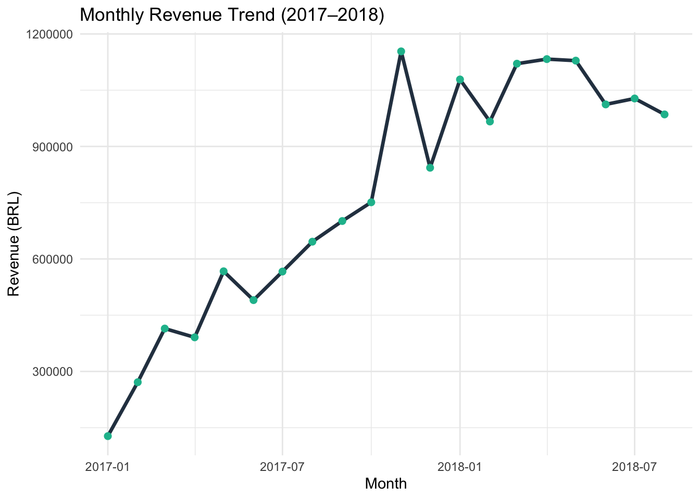
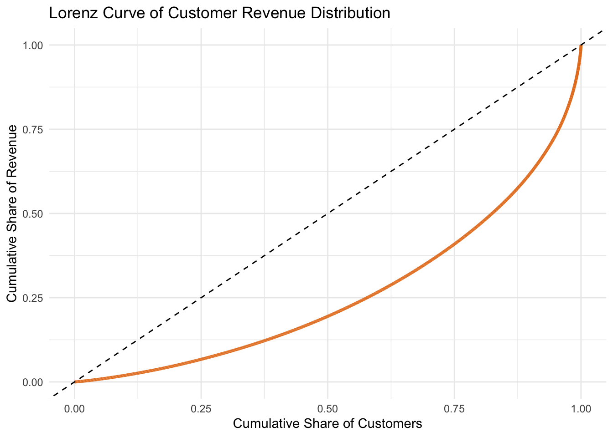

# Marketplace Revenue Risk: Olist

[](https://lilwan345.github.io/Marketplace-Revenue-Risk-Financial-Stability-Analysis/dashboard.html)
[](https://lilwan345.github.io/Marketplace-Revenue-Risk-Financial-Stability-Analysis/)
[](LICENSE)

I wanted to see how risky a marketplace's revenue really is. Like, how steady
is it month to month, how much of it depends on one region or a few big
orders, and how long does the money take to actually show up? I looked at
**96,477 delivered orders from Olist**, a Brazilian online marketplace
(2016–2018), with SQL (PostgreSQL) and R, and then built a small dashboard that
runs in the browser.

**[Open the dashboard](https://lilwan345.github.io/Marketplace-Revenue-Risk-Financial-Stability-Analysis/dashboard.html)** ·
**[Read the full report](https://lilwan345.github.io/Marketplace-Revenue-Risk-Financial-Stability-Analysis/)**

| Monthly revenue, 2017–2018 | How concentrated revenue is (Lorenz curve) |
|---|---|
|  |  |

## What I found

- **Revenue swings a lot.** The coefficient of variation (CV) of monthly
  revenue is 0.42. But Olist was still growing really fast in 2017, and growth
  by itself makes this number bigger. When I take the growth trend out the
  month-to-month swings are smaller (growth volatility 0.32).
- **A lot rides on one state.** São Paulo is 37% of revenue, then Rio at 13%
  and Minas Gerais at 12%. So more than a third comes from one state.
- **Big orders carry a lot of it.** The top 10% of orders bring in 38% of
  revenue and the top 30% bring in about 64% (Gini 0.475). Read the note below
  about what "customer" means here though.
- **The money shows up late.** About 64% of revenue is paid in installments,
  4.12 on average, so the cash comes in well after the sale. In Brazil people
  are used to paying in up to 12 interest-free installments, so 4.12 isn't
  actually that high. What matters more is how much of the revenue gets paid
  this way.

### What the numbers mean

- **CV** - the standard deviation of monthly revenue divided by its average. 0
  means every month is the same, higher means bumpier.
- **Gini** - 0 means every order is the same size, 1 means one order is
  everything.
- **HHI** (it's in the report) - square each state's share of revenue and add
  them up. It's 0.18 here, and 1 would mean all the revenue comes from one
  state. I only use it to describe the spread, I'm not comparing it to any
  official threshold.

### A note on "customers"

I caught this one later. Olist gives every order its own `customer_id`, and the
ID that actually follows a person across orders is `customer_unique_id`. My SQL
groups by `customer_id`, so the "customer" deciles in the dashboard and the
report are really ranking **orders** by value. Almost every Olist buyer only
orders once (about 97%) so the picture is close, but grouping by
`customer_unique_id` is the right way to do it and it's the next thing I'm
fixing.

## The dashboard

[`dashboard.html`](dashboard.html) is just one HTML file (plain JavaScript and
SVG, no libraries). It reads eight small CSV files from [`data/`](data/): the
KPI cards, monthly revenue, revenue by state, the decile summary, the Lorenz
curve, the payment mix, the installment distribution and a short action list.
You can also open those CSVs in Excel or whatever BI tool you like.

## How it works

1. **SQL (PostgreSQL)** builds one clean table of delivered orders (order value,
   state, installments), then views for revenue by state, by month and by
   decile ([`project.sql`](project.sql)). Deciles use `NTILE(10)`.
2. **R** ([`Analysis.Rmd`](Analysis.Rmd)) calculates the four measures, the
   growth-adjusted swing numbers and the charts (ggplot2), and renders the
   report.
3. **The dashboard** just reads the exported CSVs.

## Run it

**Only want the dashboard?** The CSVs are already in the repo:

```bash
python3 -m http.server     # then open http://localhost:8000/dashboard.html
```

If you open it straight from disk it uses a built-in copy of the same data
instead. `python3 tools/sync_dashboard_fallback.py` keeps that copy in sync with
`data/`.

**The whole analysis** (you need PostgreSQL and R):

1. Download `olist_orders_dataset.csv`, `olist_customers_dataset.csv` and
   `olist_order_payments_dataset.csv` from
   [Kaggle](https://www.kaggle.com/datasets/olistbr/brazilian-ecommerce) and
   load them into PostgreSQL as tables with the same names (no `.csv`).
2. Run [`project.sql`](project.sql) to create the views.
3. Set `PG_PASSWORD`. If your setup is different from the defaults in
   `Analysis.Rmd`, also set `OLIST_DB_NAME`, `OLIST_DB_HOST`, `OLIST_DB_PORT`
   and `OLIST_DB_USER`.
4. Render the report:

   ```r
   Rscript -e 'rmarkdown::render("Analysis.Rmd", output_file = "index.html")'
   ```

   R packages you'll need: `DBI`, `RPostgres`, `ggplot2`, `dplyr`, `ineq`.

## Files

```
project.sql       SQL views: clean orders, revenue by state, month and decile
Analysis.Rmd      the analysis in R; renders index.html (the report)
dashboard.html    the browser dashboard
data/             the eight CSVs the dashboard reads
tools/            sync_dashboard_fallback.py (keeps the dashboard's offline copy in sync)
assets/           the two charts above
```

## Data

It's the [Brazilian E-Commerce Public Dataset by Olist](https://www.kaggle.com/datasets/olistbr/brazilian-ecommerce):
99,441 orders placed between September 2016 and October 2018. I keep the
96,477 that were delivered and have payment records. The monthly charts and
the swing numbers start in January 2017, since 2016 only has a few sparse
months, and the last full month of delivered orders is August 2018.

All of this describes one marketplace in one period. The installment stuff
especially is very Brazilian, so I wouldn't compare it straight to U.S.
numbers.

---

Built by **Liyuan Wan** · [GitHub](https://github.com/lilwan345)
